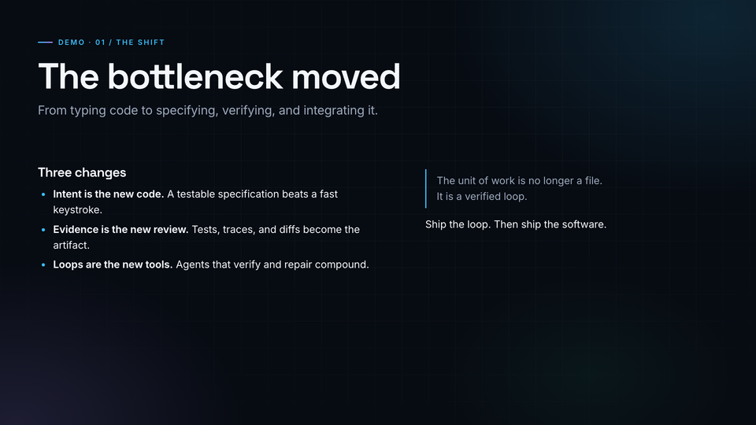
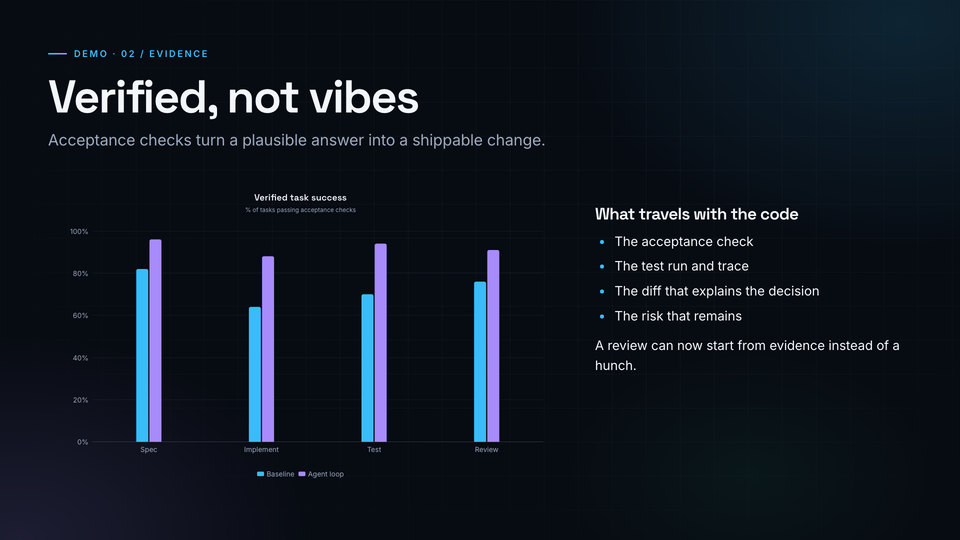
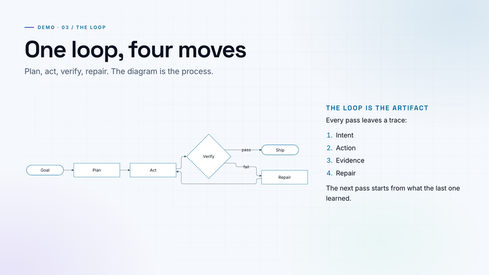
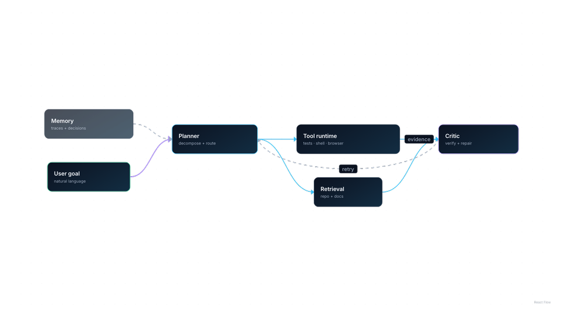

# Demo: capture a LinkZag.Show segment

This walkthrough uses the four scenes in `content/scenes/demo/` and produces every artefact the
CLI supports: still PNGs, an H.264 MP4, a transparent WebM, a ProRes 4444 MOV, a frame
sequence, and a segment package with a manifest.

Everything runs locally. The CLI starts its own renderer, captures with Playwright, and encodes
with FFmpeg.

## 0. Install

```bash
npm install
npx playwright install chromium
ffmpeg -version
ffprobe -version
```

Use Node 22.22.2 or newer. FFmpeg is only required for capture sequences and video.

## 1. Preview the demo scenes

```bash
npm run dev
```

Open `http://127.0.0.1:5174`, choose a scene in the sidebar, and use the timeline scrubber.
The studio starts on the final frame; press **Play** to restart from zero.

The demo scenes are:

| Scene | Size | Duration | Demonstrates |
| --- | --- | --- | --- |
| `demo/01-hook.yaml` | 1920×1080 | 6s | Header, markdown, quote, light/dark. |
| `demo/02-evidence.yaml` | 1920×1080 | 8s | ECharts value animation, markdown. |
| `demo/03-loop.yaml` | 1920×1080 | 8s | Mermaid draw reveal, light theme. |
| `demo/04-overlay.yaml` | 1600×900 | 6s | Transparent XYFlow overlay, progressive edges. |

## 2. Capture still PNGs

```bash
npm run render -- \
  --scene content/scenes/demo/01-hook.yaml \
  --out output/demo-stills/01-hook.png

npm run render -- \
  --scene content/scenes/demo/02-evidence.yaml \
  --out output/demo-stills/02-evidence.png

npm run render -- \
  --scene content/scenes/demo/03-loop.yaml \
  --out output/demo-stills/03-loop.png

npm run render -- \
  --scene content/scenes/demo/04-overlay.yaml \
  --transparent \
  --out output/demo-stills/04-overlay.png
```

Each `render` defaults to the final frame. Add `--time 2` for a mid-animation frame. The overlay
PNG is RGBA with transparent regions outside the diagram.

```bash
file output/demo-stills/04-overlay.png
# PNG image data, 1600 x 900, 8-bit/color RGBA, non-interlaced
```

## 3. Capture a frame sequence

```bash
npm run capture -- \
  --scene content/scenes/demo/01-hook.yaml \
  --fps 12 \
  --from 0 --to 3 \
  --out output/demo-frames
```

This writes 36 files (`round(3 × 12)`) plus `manifest.json`:

```text
output/demo-frames/
  frame-00001.png
  ...
  frame-00036.png
  manifest.json
```

The manifest records the scene checksum, time range, fps, and the time/byte count of every
frame.

## 4. Render the animated MP4

```bash
npm run video -- \
  --scene content/scenes/demo/03-loop.yaml \
  --format mp4 \
  --fps 30 \
  --out output/demo-video
```

Result: `output/demo-video/demo-loop.mp4` — 1920×1080, 30 fps, 8 seconds, H.264/yuv420p,
fast-start, no audio.

Verify it:

```bash
ffprobe -v error \
  -show_entries stream=codec_name,width,height,pix_fmt,r_frame_rate,duration \
  -of default=noprint_wrappers=1 \
  output/demo-video/demo-loop.mp4
```

Expected values include `codec_name=h264`, `pix_fmt=yuv420p`, `width=1920`, `height=1080`,
`r_frame_rate=30/1`, and `duration` close to `8.000000`.

## 5. Render transparent overlays

The XYFlow demo is a standalone transparent canvas. H.264 cannot carry alpha, so use PNG, WebM,
or MOV.

```bash
# Transparent PNG cutout
npm run render -- \
  --scene content/scenes/demo/04-overlay.yaml \
  --transparent \
  --out output/demo-overlays/overlay.png

# Animated VP9 alpha
npm run video -- \
  --scene content/scenes/demo/04-overlay.yaml \
  --format webm \
  --out output/demo-overlays

# Animated ProRes 4444 alpha
npm run video -- \
  --scene content/scenes/demo/04-overlay.yaml \
  --format mov \
  --out output/demo-overlays
```

Outputs:

```text
output/demo-overlays/
  overlay.png
  demo-overlay.webm
  demo-overlay.mov
```

`ffprobe` reports VP9 alpha as `pix_fmt=yuv420p` plus `TAG:alpha_mode=1`; that is the standard
WebM representation of a separate alpha plane. The MOV is ProRes 4444 with a `yuva…` pixel
format.

If you specifically need an MP4 overlay, composite it on a chroma-key colour:

```bash
npm run video -- \
  --scene content/scenes/demo/04-overlay.yaml \
  --format mp4 \
  --matte "#00FF00" \
  --out output/demo-overlays
```

Then key out `#00FF00` in your editor. Without `--matte`, the CLI refuses to flatten alpha and
explains the alternatives.

## 6. Build a complete segment package

```bash
npm run segment -- \
  --scene content/scenes/agentic-coding.yaml \
  --format png,mp4 \
  --out output/agentic-coding
```

```text
output/agentic-coding/
  agentic-coding-still.png
  agentic-coding.mp4
  segment.json
```

`segment.json` includes the scene checksum, resolved composition, exact options, and probed
metadata for every file. Open it to see `codec`, `pixelFormat`, `duration`, `fps`, and
`transparent`.

## 7. Render the full success video

```bash
npm run video -- \
  --scene agentic-coding \
  --format mp4 \
  --fps 30 \
  --out videos
```

Result: `videos/agentic-coding.mp4` — 1920×1080, 30 fps, 10 seconds, 300 frames.

```bash
ffprobe -v error \
  -show_entries stream=codec_name,width,height,pix_fmt,r_frame_rate,nb_frames,duration \
  -of default=noprint_wrappers=1 \
  videos/agentic-coding.mp4
```

## 8. Use a running renderer

Starting a renderer per command is convenient but adds a few seconds. During iteration, run one
renderer and pass its URL:

```bash
npm run dev:renderer -- --host 127.0.0.1 --port 5180 --strictPort
npm run render -- --scene demo-hook --base-url http://127.0.0.1:5180
```

## Output and cleanup

- `output/` and `videos/` are generated and git-ignored.
- Captured frame directories are temporary unless you pass `--keep-frames`.
- Re-running a command overwrites the same output files.
- The same scene/options/time re-renders byte-identically on the same machine.

## Visual reference

| Hook | Evidence |
| --- | --- |
|  |  |

| Loop | Transparent overlay |
| --- | --- |
|  |  |
