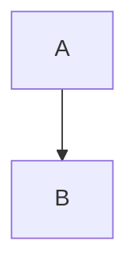

# LinkZag.Show
## Technical Handoff for Coding Agent

Version: MVP + Foundation Architecture

Goal:

Build **LinkZag.Show**, an open-ended visual storytelling and video-generation platform for technology, AI, software architecture, investing, macroeconomics, quantitative finance, and educational content.

The core idea is:

> A video is a sequence of deterministic React-rendered scenes.

NOT:

- PowerPoint generation
- AI image generation
- Video diffusion generation

Instead:

```text
Markdown/YAML/JSON
        ↓
Scene Definition
        ↓
React Scene Runtime
        ↓
Charts / Graphs / Diagrams / Callouts
        ↓
Browser Rendering
        ↓
Playwright Capture
        ↓
Frames
        ↓
FFmpeg
        ↓
MP4
```

The system should produce professional YouTube-style slideshow videos with smooth animations, charts, diagrams, timelines, and architecture visualizations.

---

# Guiding Principles

## Principle 1

Everything is a Scene.

Examples:

```text
Title Card
Architecture Diagram
Timeline
Bar Chart
Line Chart
Quote Card
Code Walkthrough
Comparison Table
Agent Graph
Investment Thesis
```

All are just scenes.

---

## Principle 2

Scenes are Data

No hardcoded presentation logic.

Scenes should be defined in:

```text
.yaml
.json
.md
```

files.

Example:

```yaml
title: Why Coding Agents Win

items:
  - type: markdown
    content: |
      # Why Coding Agents Win

  - type: mermaid
    file: coding-agent.mmd
```

---

## Principle 3

Deterministic Rendering

Given:

```bash
npm run preview \
  --scene coding-agent.yaml \
  --theme dark
```

The output should always be identical.

No randomness.

No AI generation.

No network dependency.

---

## Principle 4

Timeline Driven Animation

Avoid:

```css
animation: grow 10s;
```

Avoid:

```text
setTimeout
```

Avoid:

```text
requestAnimationFrame side effects
```

Instead:

All animations receive:

```typescript
time: number
```

Example:

```typescript
const progress = clamp(time / duration);
```

This enables exact frame reproduction.

---

# Technology Stack

## Runtime

```text
React
TypeScript
Vite
```

---

## Charts

Primary:

```text
Apache ECharts
```

Must support:

```text
Line charts
Area charts
Bar charts
Pie charts
Scatter plots
Heatmaps
Treemaps
Sankey
Graph
Candlestick
```

---

## Flow Diagrams

Primary:

```text
React Flow (XYFlow)
```

Use for:

```text
Agent architecture
System architecture
MCP diagrams
Workflow diagrams
```

---

## Mermaid

Use for:

```text
Sequence diagrams
Flow charts
ER diagrams
State diagrams
```

---

## Markdown

Use:

```text
react-markdown
remark
rehype
```

Support:

```markdown
# Title

Bullet list

Code block

Tables

Blockquotes
```

---

## Motion

Use:

```text
Framer Motion
```

ONLY for UI-level animation.

Do NOT make Framer Motion the source of truth.

Source of truth remains:

```typescript
time
```

---

## Capture

Use:

```text
Playwright
```

This is the official capture engine.

Reasons:

- already familiar
- deterministic
- supports Chromium
- captures SVG
- captures ECharts
- captures Mermaid
- captures React Flow
- can render frame sequences

Do not use Puppeteer.

No advantage.

---

## Video Assembly

Use:

```text
FFmpeg
```

for:

- frame encoding
- mp4 generation
- audio muxing

---

# Monorepo Layout

```text
linkzag-show/

apps/
  studio/
  renderer/

packages/
  scene-runtime/
  scene-components/
  scene-types/
  capture-engine/
  ffmpeg-engine/

content/
  scenes/
  assets/
  examples/

scripts/
```

---

# Application Modes

## Studio Mode

Interactive browser.

Purpose:

```text
authoring
preview
debugging
```

Command:

```bash
npm run dev
```

Features:

```text
live reload
scene switcher
theme switcher
timeline scrubber
```

---

## Render Mode

Deterministic.

Command:

```bash
npm run render
```

Example:

```bash
npm run render \
  --scene content/scenes/agent.yaml \
  --theme dark
```

No editor.

Only rendering.

---

## Capture Mode

Command:

```bash
npm run capture \
  --scene content/scenes/agent.yaml \
  --theme dark
```

Output:

```text
capture/
  frame-0001.png
  frame-0002.png
  ...
```

---

# Core Concepts

## Scene

A scene represents one page.

Example:

```yaml
id: coding-agents

duration: 10

background: transparent

items:
  - ref: title

  - ref: architecture
```

---

## Theme

Support:

```text
light
dark
```

via query parameter.

Example:

```text
/?scene=agent&theme=dark
```

and

```text
/?scene=agent&theme=light
```

---

## Item

An item represents a renderable component.

Example:

```yaml
items:
  - type: markdown

  - type: echarts

  - type: xyflow

  - type: mermaid
```

---

# Supported Components (MVP)

## Markdown Scene

```yaml
type: markdown
```

Input:

```markdown
# Title
```

---

## ECharts Scene

```yaml
type: echarts
```

Input:

```json
{
  "series":[]
}
```

---

## Mermaid Scene

```yaml
type: mermaid
```

Input:



---

## XYFlow Scene

```yaml
type: xyflow
```

Input:

```json
{
  "nodes": [],
  "edges": []
}
```

---

## Image Scene

```yaml
type: image
```

Input:

```text
png
svg
jpeg
webp
```

---

## Quote Scene

```yaml
type: quote
```

For podcast excerpts.

---

## Code Scene

```yaml
type: code
```

Supports:

```text
typescript
python
rust
go
```

---

# Layout System

No cards.

No dashboards.

No application chrome.

No menus.

No page titlebars.

No navigation.

This is NOT an application UI.

It is a visual rendering engine.

Use:

```text
absolute positioning
```

Example:

```yaml
x: 100
y: 200

width: 700
height: 300
```

Everything should be placeable.

---

# Animation System

Each scene receives:

```typescript
time
```

Example:

```typescript
interface SceneContext {
  time: number;
  duration: number;
  theme: Theme;
}
```

---

Example:

```typescript
const progress =
  Math.min(time / 6, 1);
```

---

Examples:

```text
fade in
slide in
grow line
grow bar
highlight node
draw edge
```

All derived from:

```typescript
time
```

---

# URL API

Examples:

```text
/?scene=agent.yaml
```

```text
/?scene=agent.yaml&theme=dark
```

```text
/?scene=agent.yaml&theme=dark&t=5
```

```text
/?scene=agent.yaml&theme=dark&t=5&w=1920&h=1080
```

Definitions:

```text
scene = file
theme = dark/light
t = animation time
w = width
h = height
```

---

# Capture Engine

Build Playwright capture runner.

Example:

```bash
npm run capture \
  --scene content/scenes/agent.yaml \
  --theme dark \
  --fps 30 \
  --duration 10
```

Expected output:

```text
capture/
  frame-000001.png
  frame-000002.png
  ...
  frame-000300.png
```

---

# Video Build

Example:

```bash
npm run video \
  --scene content/scenes/agent.yaml \
  --theme dark
```

Steps:

```text
1. render frames
2. generate mp4
3. store output
```

Output:

```text
videos/agent.mp4
```

---

# Future Extensions

Not MVP.

Design architecture so these can be added later.

## Narration

```text
Edge TTS
Azure TTS
OpenAI TTS
```

---

## Captions

```text
SRT
VTT
```

---

## Podcast Visualizer

Input:

```text
podcast transcript
```

Output:

```text
timeline scenes
quote cards
supporting diagrams
```

---

## AI Storyboard Generator

Input:

```text
article
transcript
podcast
```

Output:

```yaml
scene definition
```

---

## Motion Graphics Library

Future reusable components:

```text
Timeline
Comparison
Feature Matrix
Investment Thesis
Company Ecosystem
Agent Network
Token Flow
Macro Cycle
Market Structure
```

---

# Testing Requirements

## Unit Tests

Vitest.

Test:

```text
scene loading
schema validation
theme handling
component rendering
```

---

## Integration Tests

Vitest.

Test:

```text
yaml -> scene conversion
json -> chart rendering
```

---

## End-to-End Tests

Playwright.

Test:

```text
render scene
capture frame
verify image exists
verify dimensions
verify theme
```

---

## Golden Snapshot Tests

For deterministic rendering.

Store reference PNG.

Compare:

```text
light theme
dark theme
```

Outputs.

---

# Success Criteria

A user can create:

```text
content/scenes/agentic-coding.yaml
```

run:

```bash
npm run video \
  --scene content/scenes/agentic-coding.yaml \
  --theme dark
```

and obtain:

```text
videos/agentic-coding.mp4
```

containing:

- charts
- diagrams
- markdown
- animations
- consistent rendering
- no manual editing

while remaining fully local and reproducible on:

- MacBook M2
- Windows workstation
- Linux workstation

without requiring cloud rendering or generative AI.
